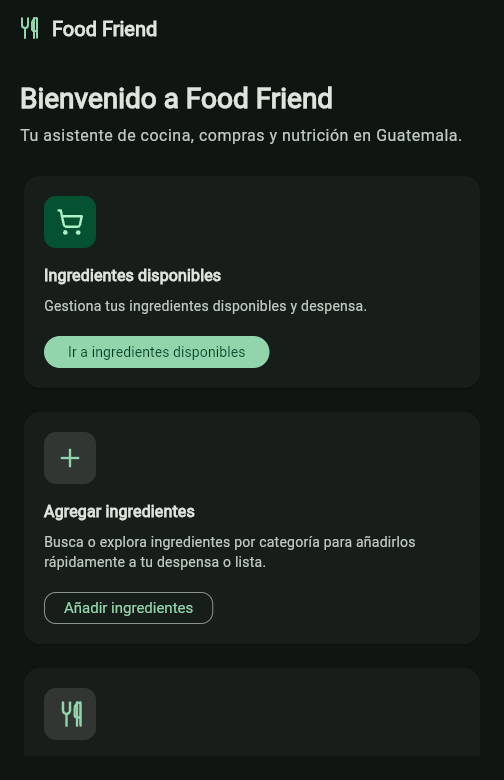
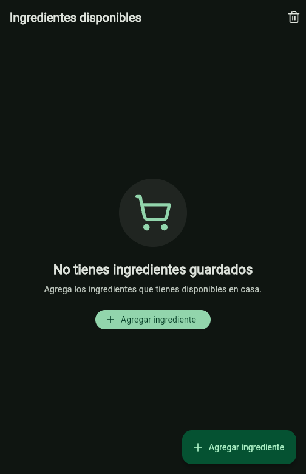
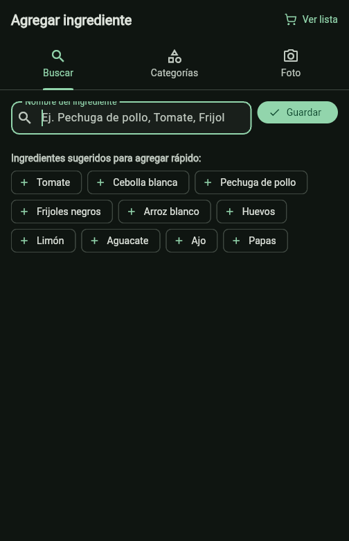
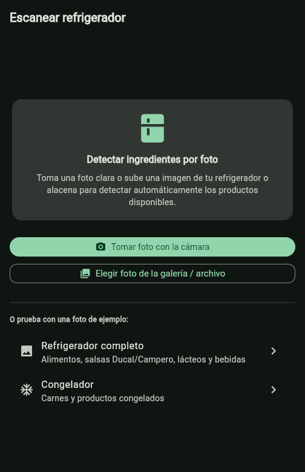
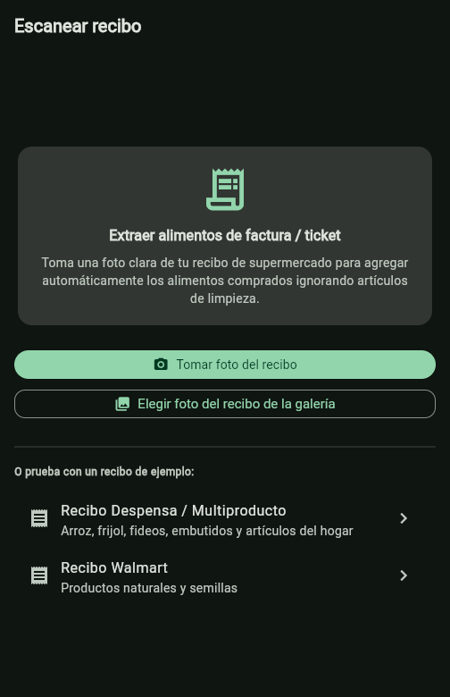
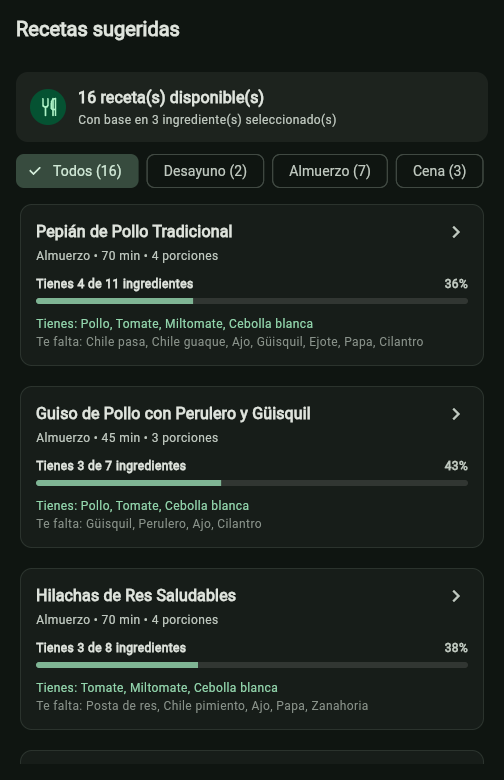
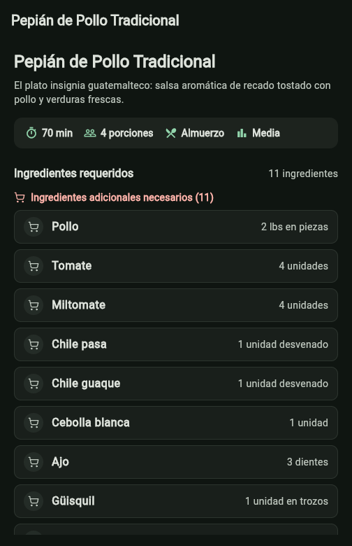
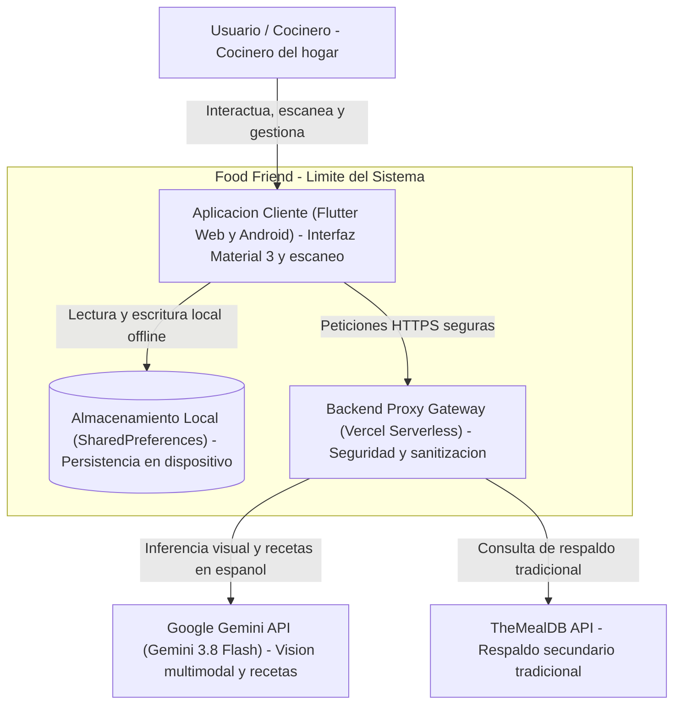

# Food Friend

> **Tu asistente inteligente de cocina, compras y nutrición.**

**Food Friend** es una aplicación multiplataforma (*Flutter Web & Android*) diseñada para ayudar a las familias y cocineros del hogar a reducir el desperdicio de alimentos, aprovechar al máximo los ingredientes disponibles en su despensa y descubrir recetas saludables, deliciosas y adaptadas a la cultura culinaria guatemalteca y latinoamericana.

---

## Vistas Principales

| Pantalla Principal | Ingredientes Disponibles | Agregar Ingrediente |
| :---: | :---: | :---: |
|  |  |  |

| Escaneo Refrigerador | Factura Supermercado | Sugerencias de Recetas | Detalle de Receta |
| :---: | :---: | :---: | :---: |
|  |  |  |  |

---

## Funcionalidades Clave

- **Gestión de Despensa Local (*Offline-First*):** Registro y control de ingredientes disponibles con persistencia local en el dispositivo del usuario, garantizando total privacidad.
- **Entrada Manual Predictiva:** Búsqueda en tiempo real sobre un catálogo de más de 170 ingredientes guatemaltecos con tolerancia a errores tipográficos (*Levenshtein distance*) y árbol taxonómico navegable en menos de 4 toques.
- **Escaneo Inteligente por Foto:** Detección de alimentos en fotos de refrigeradores/congeladores y extracción de compras en facturas de supermercado en Quetzales (`GTQ` / `Q`) mediante visión computacional con **Gemini 3.8 Flash**.
- **Motor Culinario Multinivel:** Recetario local de 16 platillos auténticos precargados en español, combinado con generación dinámica asistida por IA para combinaciones poco convencionales y respaldo secundario tradicional con *TheMealDB*.
- **Planificación de Comidas:** Filtros rápidos por tiempo de comida (*Desayuno*, *Almuerzo*, *Cena*, *Snack*) y desglose automático de ingredientes que ya tienes en casa frente a ingredientes faltantes.

---

## Arquitectura del Sistema

Diagrama de contenedores generado con la habilidad `diagram` mostrando la interacción entre componentes:



---

## Guía de Inicio Rápido

### 1. Requisitos Previos
- **Flutter SDK:** $\ge 3.24$
- **Node.js:** $\ge 20.x$ (recomendado 22.x)
- **Google Chrome** (para pruebas en la web)
- **Clave de API de Gemini:** Gratuita en [Google AI Studio](https://aistudio.google.com/)

### 2. Instalación y Configuración
```bash
# 1. Clonar el repositorio
git clone https://github.com/luiscu/food-friend.git
cd food-friend

# 2. Instalar dependencias
flutter pub get
npm install

# 3. Configurar variables de entorno
cp .env.example .env.local
# Agregue su GEMINI_API_KEY en .env.local
```

### 3. Ejecución en Desarrollo
Inicie simultáneamente el backend proxy (`:3000`) y el frontend Flutter Web (`:8080`):
```bash
npm run dev
# O en Windows: .\serve.ps1
```

### 4. Despliegue
- **Web (*Vercel*):**
  ```bash
  flutter build web --release
  npx vercel --prod
  ```
- **Android (*APK*):**
  ```bash
  flutter build apk --release
  # Salida: build/app/outputs/flutter-apk/app-release.apk
  ```

---

## Documentación Detallada

Para consultar la documentación técnica completa del proyecto, visite la carpeta [`docs/readme/`](docs/readme/):

- **[Arquitectura Técnica y Diagramas C4](docs/readme/arquitectura.md):** Especificación por capas, límites de seguridad y grafo de dependencias de módulos.
- **[Modelos de Datos y Diagrama ER](docs/readme/modelos_datos.md):** Entidades de dominio, taxonomía culinaria y cardinalidades.
- **[Integración de LLM y Estrategia de Fallbacks](docs/readme/llamadas_llm.md):** Prompts, esquemas JSON con Gemini 3.8 Flash y resiliencia multinivel.
- **[Guía Completa de Instalación y Despliegue](docs/readme/guia_instalacion_despliegue.md):** Manual detallado para entornos locales, Vercel y Android.
- **[Estrategia y Reporte de Pruebas](docs/readme/pruebas.md):** Pruebas unitarias, de widgets y pruebas *end-to-end* con 119 casos exitosos.
- **[Documentación: Entrada de Ingredientes (Fases 2 y 3)](docs/readme/ADD_INGREDIENTS.md):** Catálogo, búsqueda predictiva y escaneo fotográfico.
- **[Documentación: Descubrimiento de Recetas (Fase 4)](docs/readme/GET_RECIPES.md):** Algoritmo de puntuación, recetas locales y generación con Gemini.
