# Food Friend

**Food Friend** es un asistente inteligente de cocina, compras y nutrición diseñado para hogares en Guatemala y Latinoamérica. Permite administrar los ingredientes disponibles en casa, organizar una lista de compras independiente, descubrir recetas saludables con variaciones culinarias y recibir consejos nutricionales personalizados a partir de las comidas preparadas, operando de forma rápida, privada y con soporte sin conexión (*Offline-First*) en **Web** y **Android**.

---

## Capturas de Pantalla de las Vistas Principales

| Pantalla Principal | Mis Ingredientes (Despensa) | Agregar Ingrediente | Lista de Compras (*Por comprar*) |
| :---: | :---: | :---: | :---: |
| 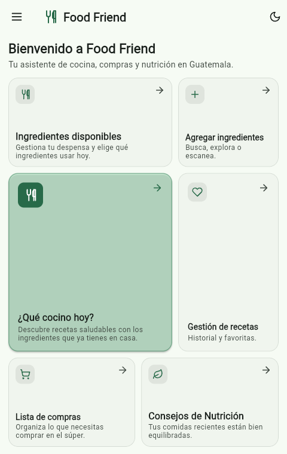 | 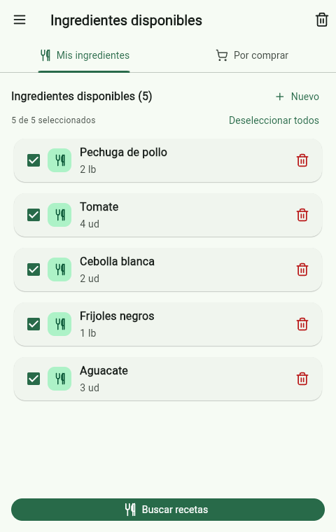 | 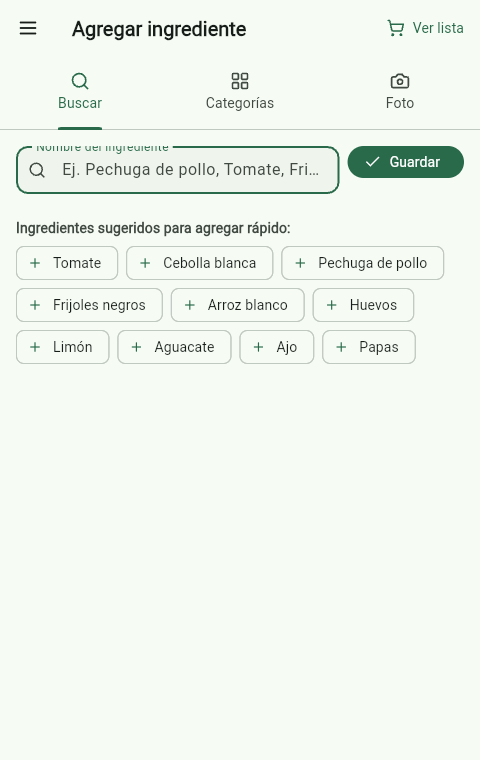 | 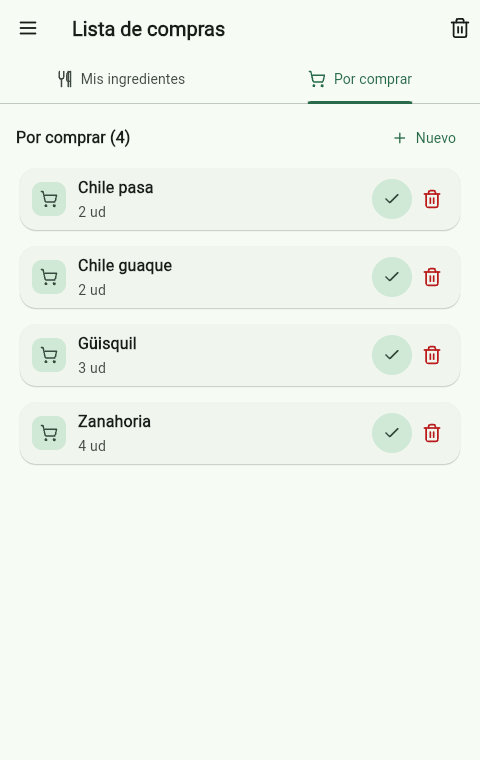 |

| Escaneo de Refrigerador | Escaneo de Factura (`GTQ`) | Recetas Sugeridas | Detalle y Variaciones |
| :---: | :---: | :---: | :---: |
| 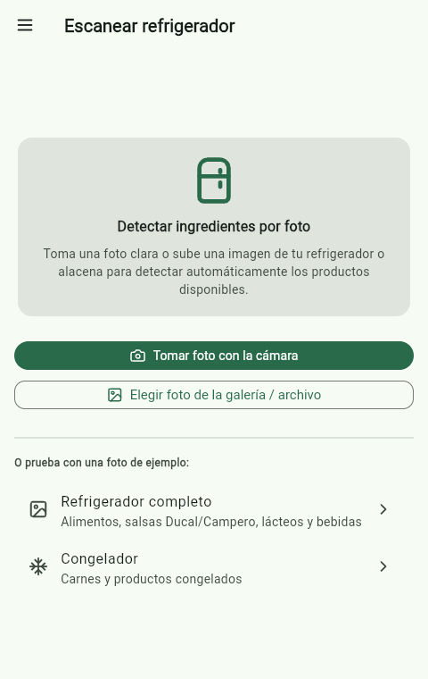 | 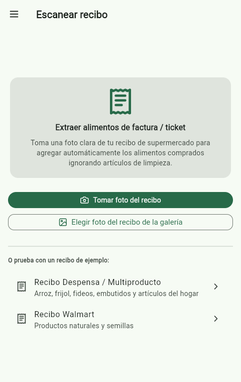 | 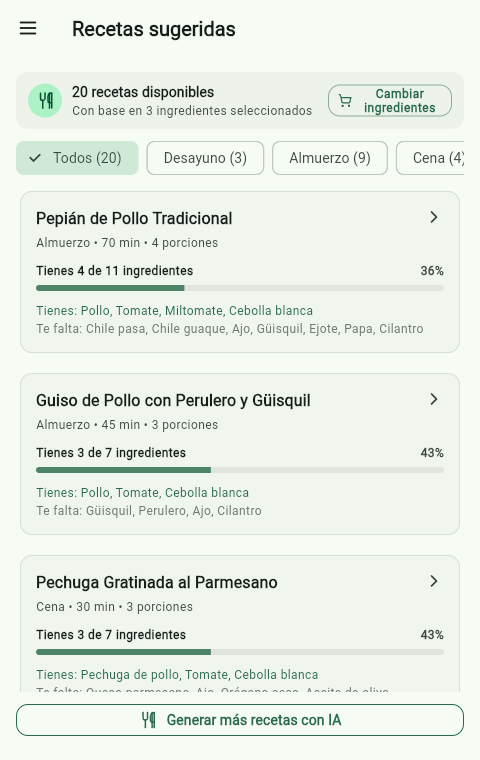 | 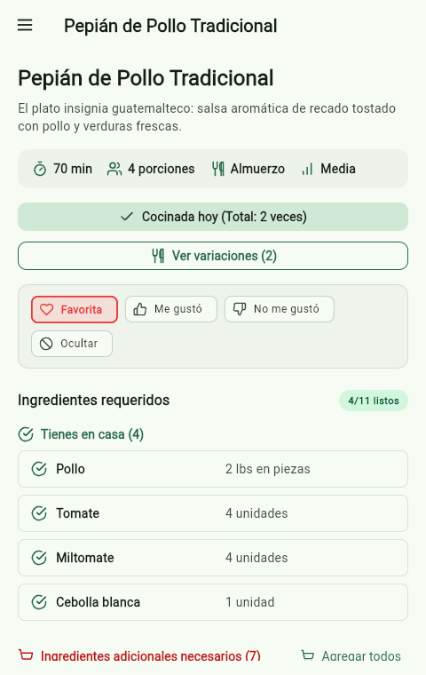 |

| Gestión de Recetas | Consejos de Nutrición | Configuración y Personalización |
| :---: | :---: | :---: |
| 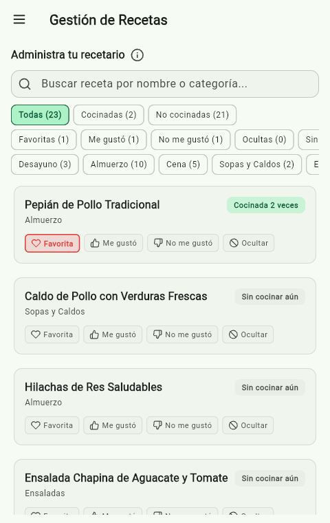 | 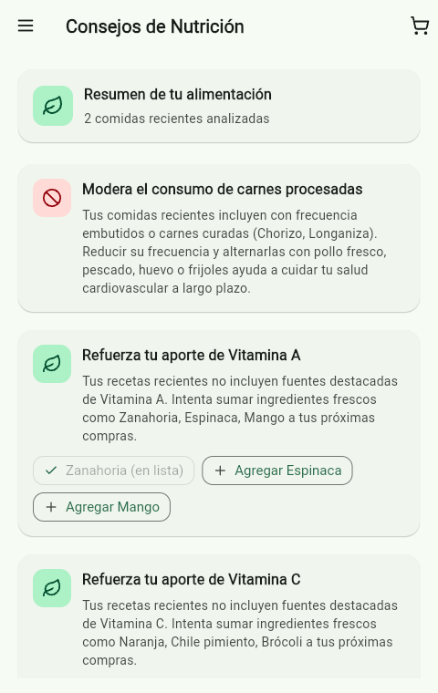 | 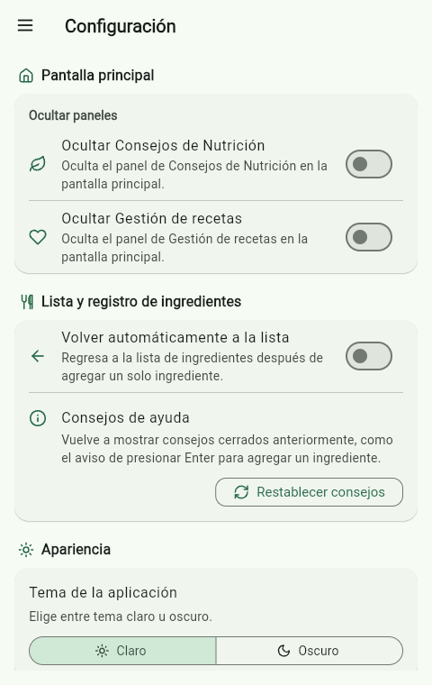 |

---

## Funcionalidades Principales

- **Gestión de Despensa y Taxonomía Local:** Catálogo de **195+ ingredientes** organizados con las clasificaciones cotidianas de supermercados guatemaltecos, búsqueda predictiva con tolerancia a errores tipográficos y exploración jerárquica en $\le 4$ niveles.
- **Escaneo Inteligente por Fotografía:** Detección multimodal de alimentos en refrigeradores/alacenas y extracción automática de productos comestibles y precios en Quetzales (`GTQ` / `Q`) desde facturas de supermercado mediante **Gemini 3.8 Flash**.
- **Lista de Compras Independiente:** Separación entre inventario en casa (*Mis ingredientes*) y compras pendientes (*Por comprar*), con acciones directas para transferir productos adquiridos a la despensa (`Comprado`) o descartarlos (`Descartar`).
- **Descubrimiento de Recetas, Variaciones e IA Bajo Demanda:** Recetario local de **23 platillos saludables**, visor de variaciones para *meal prep* (`"Ver variaciones"`), generación bajo demanda (`"Generar más recetas con IA"`) y respaldo multinivel (*fallback*).
- **Historial Culinario y Preferencias:** Registro diario con idempotencia (`"Lo cociné"`), marcas de preferencia (*Favorita*, *Me gustó*, *No me gustó*, *Nunca*) y pantalla dedicada de **Gestión de Recetas**.
- **Consejos de Nutrición Basados en Historial:** Motor local y determinista que evalúa las comidas cocinadas para alertar sobre exceso de embutidos, detectar vitaminas faltantes (con adición en 1 toque a la lista de compras) y sugerir combinaciones de proteína vegetal completa (como arroz + frijol).

---

## Diagrama de Arquitectura

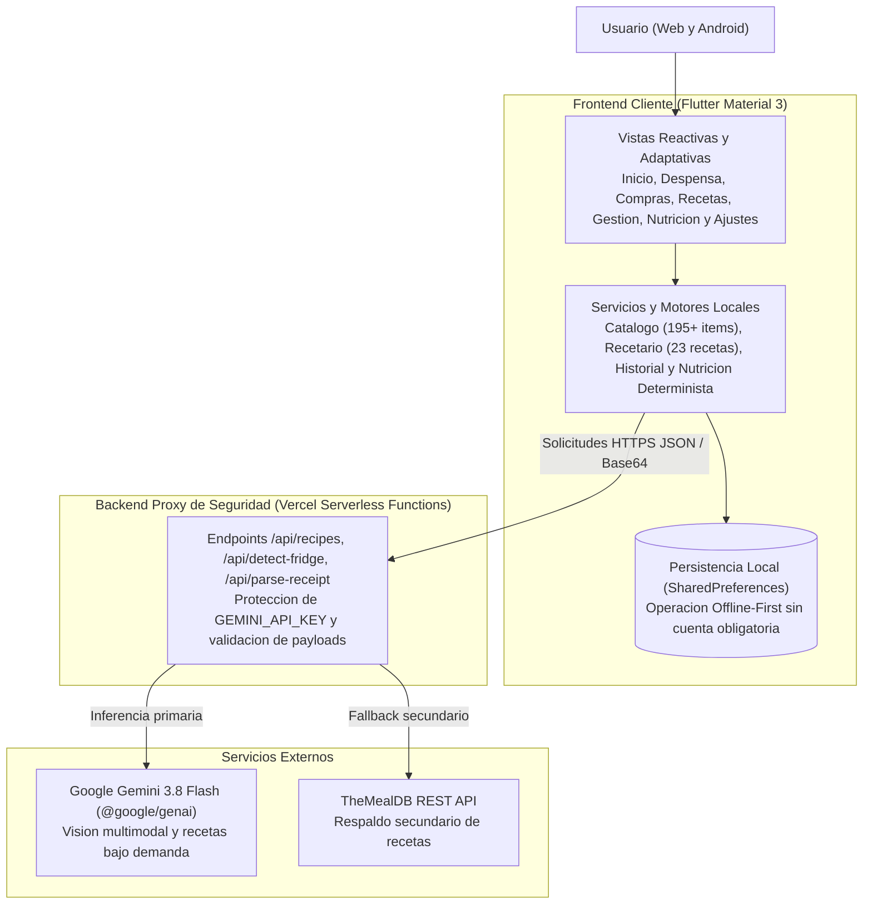

---

## Comparativa Competitiva y Estado de Implementación

Resumen comparativo basado en [`COMPETITIVE_ANALYSIS.md`](COMPETITIVE_ANALYSIS.md) frente a alternativas internacionales (*SuperCook*, *Cookpad*, *Samsung Food*, *KitchenPal* y *PlantJammer*):

| Característica / Capacidad | Alternativas Actuales (*SuperCook*, *Cookpad*, *KitchenPal*) | Food Friend | Estado en Food Friend |
| :--- | :--- | :--- | :---: |
| **Enfoque en Guatemala y Latinoamérica** | Catálogos centrados en EE. UU. y Europa | Ingredientes, platillos y léxico de supermercados guatemaltecos | **Implementado** |
| **Búsqueda de recetas por ingredientes disponibles** | Sí (principalmente en inglés o por comunidad) | Algoritmo de coincidencia + 23 recetas locales + IA bajo demanda | **Implementado** |
| **Inventario de despensa local (*Mis ingredientes*)** | Requiere cuenta en la nube o suscripción | Almacenamiento local inmediato y privado en el dispositivo | **Implementado** |
| **Escaneo fotográfico de refrigerador / despensa** | Limitado o restringido a planes de pago | Visión multimodal con Gemini 3.8 Flash ordenada por certeza | **Implementado** |
| **Escaneo de facturas de supermercado locales** | No reconocen abreviaturas *POS* de Guatemala | Extracción de alimentos y montos en Quetzales (`GTQ` / `Q`) | **Implementado** |
| **Lista de compras conectada a recetas y nutrición** | Básica o desconectada de la nutrición | Pestaña *Por comprar* con transferencia en 1 toque (`Comprado` / `Descartar`) | **Implementado** |
| **Variaciones de recetas para *meal prep*** | Sólo en herramientas de pago (*PlantJammer*) | Visor de variaciones predefinidas e intercambio de ingredientes | **Implementado** |
| **Historial de cocina y preferencias de usuario** | Básico (solo guardado de favoritos) | Registro `"Lo cociné"` e impacto en *ranking* (*Favorita*, *Me gustó*, *No me gustó*, *Nunca*) | **Implementado** |
| **Consejos nutricionales basados en comidas reales** | Calculadoras pasivas de calorías | Alertas de embutidos, vitaminas faltantes y proteínas completas (arroz + frijol) | **Implementado** |
| **Operación *Offline-First* y sin cuenta obligatoria** | Exigen conexión permanente e inicio de sesión | Catálogo, recetario, historial y nutrición 100% funcionales sin red | **Implementado** |
| **Seguimiento y alertas de fechas de vencimiento** | Disponible en *KitchenPal* | Modelo de datos preparado (`expirationDate`); interfaz de alertas programada | **Pendiente** |
| **Filtros por tiempo máximo de cocción** | Disponible en *SuperCook* | Tiempos mostrados en cada receta; filtro por minutos programado | **Pendiente** |
| **Notificaciones por cercanía (*GPS* local) a mercados** | No disponible en competidores | Planeado con procesamiento estrictamente local en el dispositivo | **Pendiente** |
| **Detección de ofertas locales vía *web scraping*** | No disponible en Guatemala | Planeado para cadenas de supermercados locales | **Pendiente** |

---

## Guía Rápida de Inicio

### 1. Instalar Dependencias
```powershell
git clone https://github.com/luiscu/food-friend.git
cd food-friend
flutter pub get
npm install
```

### 2. Configurar Variables de Entorno
Cree un archivo `.env.local` en la raíz a partir de `.env.example`:
```env
GEMINI_API_KEY=tu_clave_de_google_ai_studio
PORT=3000
```

### 3. Ejecutar en Desarrollo Local
```powershell
# Inicia simultáneamente el proxy API (puerto 3000) y Flutter Web (puerto 8080)
.\serve.ps1
# Alternativas: serve.bat o npm run dev
```

### 4. Ejecutar Pruebas
```powershell
flutter analyze
npm run typecheck
flutter test
```

### 5. Desplegar en Producción
- **Web y *Serverless Functions* (Vercel):** Importe el repositorio en Vercel (el archivo `vercel.json` y `scripts/build-vercel.sh` compilan Flutter Web y publican `/api/*` automáticamente) o ejecute `npx vercel --prod`. Configure `GEMINI_API_KEY` en las variables de entorno del proyecto.
- **Android (`APK`):** Ejecute `flutter build apk --release` para generar el instalador en `build/app/outputs/flutter-apk/app-release.apk`.

---

## Documentación Detallada (`docs/readme/`)

Para consultar los detalles técnicos de implementación, diagramas adicionales y guías completas, revise los siguientes documentos:

1. [**Arquitectura del Sistema (`arquitectura.md`)**](docs/readme/arquitectura.md): Diagramas *C4 Context*, *C4 Container*, grafo de dependencias entre módulos y flujos de secuencia.
2. [**Entrada de Ingredientes y Lista de Compras (`ADD_INGREDIENTS.md`)**](docs/readme/ADD_INGREDIENTS.md): Implementación del catálogo de 195+ ingredientes, taxonomía de supermercado, escaneo de refrigerador/facturas y lista *Por comprar*.
3. [**Descubrimiento, Variaciones y Gestión de Recetas (`GET_RECIPES.md`)**](docs/readme/GET_RECIPES.md): Algoritmo de coincidencia, 23 recetas locales, variaciones culinarias, IA bajo demanda e historial `"Lo cociné"`.
4. [**Consejos de Nutrición (`NUTRITION_TIPS.md`)**](docs/readme/NUTRITION_TIPS.md): Reglas deterministas de evaluación nutricional (embutidos, vitaminas y proteínas completas) e integración con compras.
5. [**Modelos de Datos (`modelos_datos.md`)**](docs/readme/modelos_datos.md): Diagrama Entidad-Relación (*ER*) y especificación de todas las entidades de dominio.
6. [**Llamadas a *LLM* y Estrategia de Respaldo (`llamadas_llm.md`)**](docs/readme/llamadas_llm.md): Diseño de *prompts*, seguridad del *proxy* y degradación elegante (*fallbacks*).
7. [**Guía de Instalación, Ejecución y Despliegue (`guia_instalacion_despliegue.md`)**](docs/readme/guia_instalacion_despliegue.md): Instrucciones completas para desarrollo local, despliegue en Vercel (incluyendo organizaciones de GitHub en capa gratuita) y compilación de *APK*.
8. [**Estrategia y Reporte de Pruebas (`pruebas.md`)**](docs/readme/pruebas.md): Pirámide de pruebas y desglose de pruebas unitarias, de *widgets*, *backend* e integración *end-to-end*.
