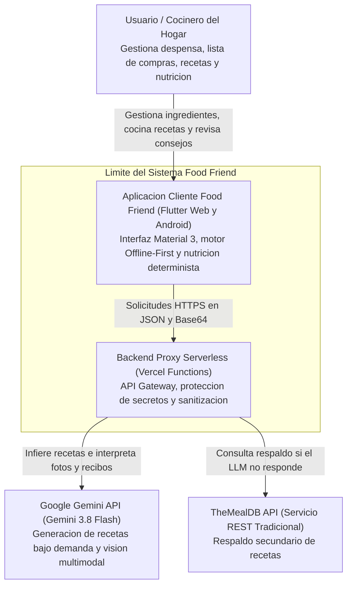
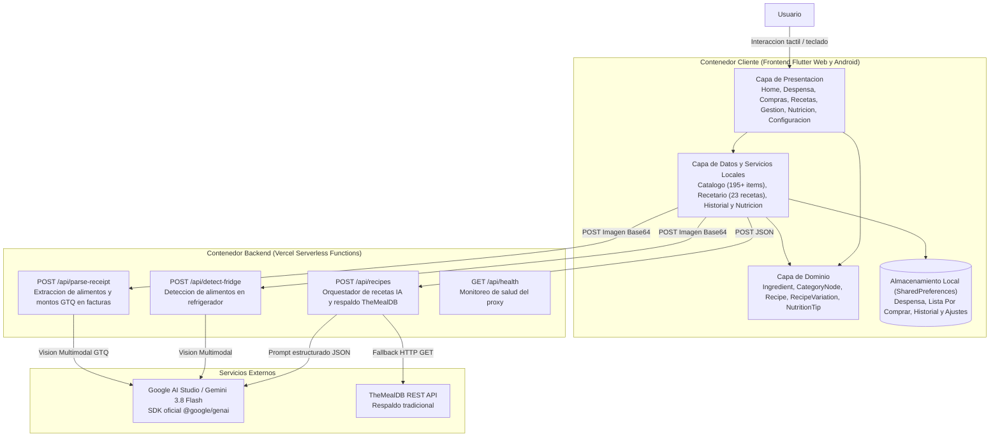
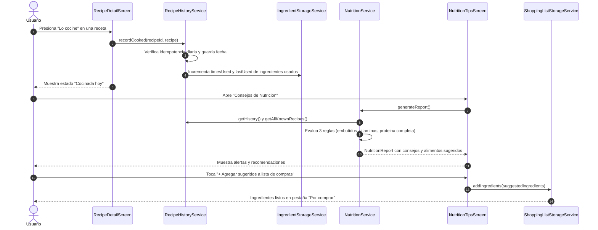

# Arquitectura del Sistema - Food Friend

Este documento describe la arquitectura técnica, las capas de diseño y los componentes principales de **Food Friend**, un asistente integral de cocina, compras y nutrición diseñado para operar fluidamente en la web y en dispositivos móviles (*Android*).

---

## 1. Perfil del Sistema

- **Tipo de Arquitectura:** Cliente híbrido multiplataforma (*Flutter Web & Android*) conectado a un *gateway* de seguridad *serverless* (*Vercel Serverless Functions* en *Node.js / TypeScript*) y servicios externos de inteligencia artificial (*Google Gemini 3.8 Flash*).
- **Patrón de Diseño:** Arquitectura limpia por capas (*Layered Architecture*):
  - **Capa de Presentación (*UI & Controllers*):** *Widgets* reactivos de *Flutter Material 3*, diseño responsivo fluido (`ResponsiveContainer`, *breakpoints* móvil/escritorio), menú de navegación global (`AppNavigationDrawer`) y controladores de personalización (`ThemeController`, `SettingsController`).
  - **Capa de Dominio (*Domain Models & Business Rules*):** Entidades inmutables para ingredientes, taxonomía de supermercado, recetas, variaciones culinarias, historial de cocción, preferencias y perfiles nutricionales.
  - **Capa de Datos y Servicios (*Data Access & Repositories*):** Persistencia local sin conexión (*Offline-First*) vía `shared_preferences` para despensa (`IngredientStorageService`), lista de compras (`ShoppingListStorageService`), historial de recetas (`RecipeHistoryService`), motor determinista de nutrición (`NutritionService`) y clientes HTTP hacia el *proxy*.
  - **Capa de *Backend Proxy* (*API Gateway*):** Funciones *serverless* en `api/*` encargadas de proteger claves secretas (`GEMINI_API_KEY`), validar entradas, ejecutar inferencia multimodal y orquestar niveles de respaldo (*fallbacks*).
- **Almacenamiento Local:** Persistencia en el dispositivo del usuario mediante clave-valor serializado en JSON (`shared_preferences`), garantizando privacidad total sin necesidad de cuentas ni servidores de base de datos externos.

---

## 2. Diagrama de Contexto del Sistema (*C4 Context*)

El siguiente diagrama muestra los límites del sistema, el usuario final y los servicios externos con los que interactúa:

---

## 3. Diagrama de Contenedores (*C4 Container*)

Detalle de los contenedores que conforman la solución, sus protocolos de comunicación y sus responsabilidades específicas:

---

## 4. Grafo de Dependencias entre Módulos

Estructura modular del código en Dart (*Frontend*), evidenciando la separación de responsabilidades entre las seis áreas funcionales (`home`, `ingredients`, `shopping_list`, `recipes`, `nutrition`, `settings`) y el núcleo compartido (`core`):

```mermaid
graph TD
    subgraph UI_Layer ["Capa de Presentacion (lib/features/*/presentation)"]
        HomeView["home_screen.dart"]
        ShoppingListView["shopping_list_screen.dart"]
        AddIngredientView["add_ingredient_screen.dart"]
        FridgeScannerView["fridge_scanner_screen.dart"]
        ReceiptScannerView["receipt_scanner_screen.dart"]
        RecipeSuggestionsView["recipe_suggestions_screen.dart"]
        RecipeDetailView["recipe_detail_screen.dart"]
        RecipeManagementView["recipe_management_screen.dart"]
        NutritionTipsView["nutrition_tips_screen.dart"]
        SettingsView["settings_screen.dart"]
    end

    subgraph Service_Layer ["Capa de Servicios y Datos (lib/features/*/data)"]
        PantryStorage["ingredient_storage_service.dart"]
        ShoppingStorage["shopping_list_storage_service.dart"]
        CatalogData["ingredient_catalog.dart"]
        LocalRecipes["local_recipe_dataset.dart"]
        RecipeSearch["recipe_search_service.dart"]
        RecipeHistory["recipe_history_service.dart"]
        ExternalRecipes["external_recipe_service.dart"]
        FridgeService["fridge_vision_service.dart"]
        ReceiptService["receipt_parser_service.dart"]
        NutritionSvc["nutrition_service.dart"]
        NutritionCat["nutrition_catalog.dart"]
    end

    subgraph Core_Layer ["Nucleo Compartido (lib/core/*)"]
        NavDrawer["app_navigation_drawer.dart"]
        SettingsCtrl["settings_controller.dart"]
        ThemeCtrl["theme_controller.dart"]
        ResponsiveCore["responsive_layout.dart"]
        NormalizerCore["string_normalizer.dart"]
    end

    HomeView --> PantryStorage
    HomeView --> NutritionSvc
    HomeView --> SettingsCtrl
    ShoppingListView --> PantryStorage
    ShoppingListView --> ShoppingStorage
    AddIngredientView --> CatalogData
    AddIngredientView --> PantryStorage
    AddIngredientView --> SettingsCtrl
    FridgeScannerView --> FridgeService
    FridgeScannerView --> PantryStorage
    ReceiptScannerView --> ReceiptService
    ReceiptScannerView --> PantryStorage
    RecipeSuggestionsView --> RecipeSearch
    RecipeSuggestionsView --> RecipeHistory
    RecipeDetailView --> RecipeHistory
    RecipeDetailView --> ShoppingStorage
    RecipeManagementView --> RecipeHistory
    NutritionTipsView --> NutritionSvc
    NutritionTipsView --> ShoppingStorage
    SettingsView --> SettingsCtrl
    SettingsView --> ThemeCtrl

    ShoppingStorage --> PantryStorage
    RecipeSearch --> LocalRecipes
    RecipeSearch --> ExternalRecipes
    RecipeSearch --> RecipeHistory
    RecipeHistory --> PantryStorage
    RecipeHistory --> LocalRecipes
    NutritionSvc --> RecipeHistory
    NutritionSvc --> NutritionCat
    CatalogData --> NormalizerCore
    UI_Layer --> NavDrawer
    UI_Layer --> ResponsiveCore
```

---

## 5. Flujo de Interacción Entre Historial Culinario, Nutrición y Compras

El siguiente diagrama de secuencia muestra cómo las acciones cotidianas del usuario (registrar `"Lo cociné"` en una receta) alimentan de forma determinista el motor nutricional y se conectan con la lista de compras:

---

## 6. Principios de Seguridad, Privacidad y Resiliencia

1. **Aislamiento de Secretos:** La aplicación cliente jamás almacena ni expone credenciales de *Google AI Studio*. Todas las peticiones a la IA se enrutan a través del *backend proxy* en `/api/*`, que inyecta `process.env.GEMINI_API_KEY` en el servidor.
2. **Privacidad *Local-First*:** El inventario de despensa, la lista de compras, el historial de recetas cocinadas, las marcas de preferencia y la evaluación nutricional viven íntegramente en el almacenamiento local del dispositivo del usuario.
3. **Resiliencia *Offline-First*:** Si el dispositivo pierde conectividad o el servicio de IA no está disponible, el usuario conserva acceso total al catálogo de 195+ ingredientes, las 23 recetas locales con sus variaciones, el historial culinario, la lista de compras y el motor de consejos nutricionales.
