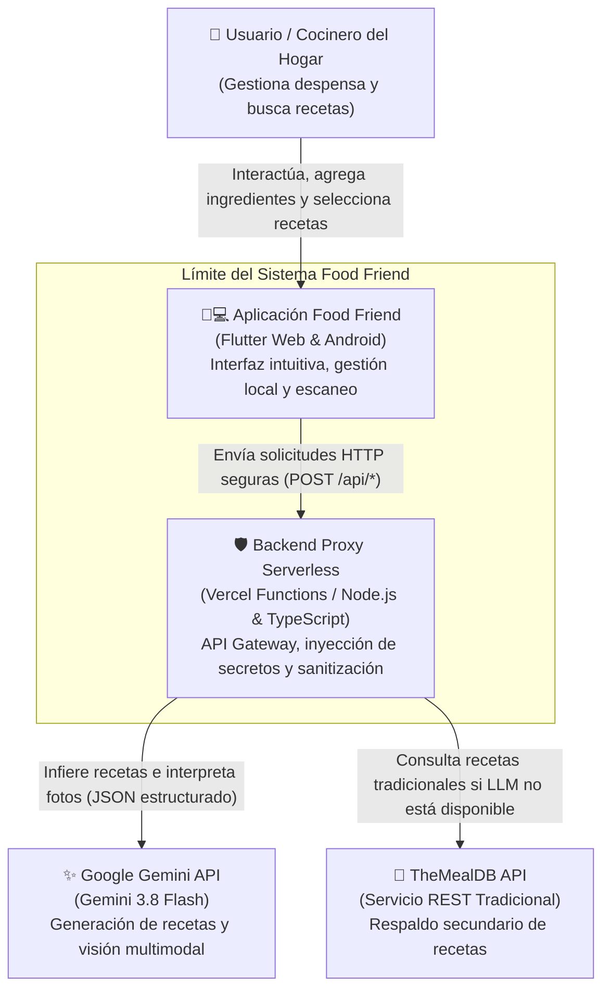
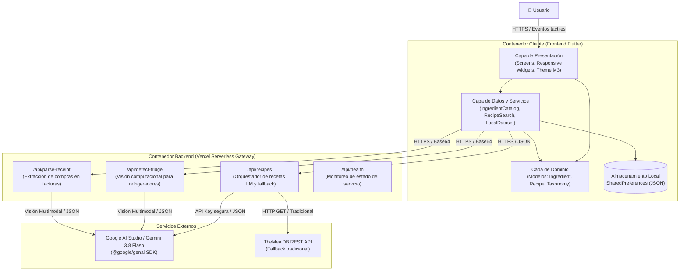

# Arquitectura del Sistema - Food Friend

Este documento describe la arquitectura técnica, las capas de diseño y los componentes principales de **Food Friend**, un asistente integral de cocina, compras y nutrición diseñado para operar fluidamente en la web y en dispositivos móviles (*Android*).

---

## 1. Perfil del Sistema

- **Tipo de Arquitectura:** Cliente híbrido multiplataforma (*Flutter Web & Android*) conectado a un *gateway* de seguridad *serverless* (*Vercel Serverless Functions* en *Node.js / TypeScript*) y servicios externos de inteligencia artificial (*Google Gemini 3.8 Flash*).
- **Patrón de Diseño:** Arquitectura por capas (*Clean / Layered Architecture*):
  - **Capa de Presentación (*UI & Controllers*):** *Widgets* reactivos de *Flutter Material 3*, componentes responsivos y gestión de estado con flujos síncronos y asíncronos.
  - **Capa de Dominio (*Domain Models & Business Rules*):** Entidades inmutables, árboles taxonómicos y algoritmos de coincidencia culinaria.
  - **Capa de Datos (*Data Access & Repositories*):** Persistencia local sin conexión (*offline-first*) vía `shared_preferences`, catálogo taxonómico en memoria, *dataset* local de recetas y servicios de comunicación HTTP.
  - **Capa de *Backend Proxy* (*API Gateway*):** Funciones *serverless* seguras para protección de claves de API (*API keys*), saneamiento de entradas, procesamiento multimodal de imágenes y orquestación de *fallbacks*.
- **Almacenamiento Local:** Persistencia en disco del dispositivo del usuario mediante clave-valor serializado en JSON (`shared_preferences`), garantizando privacidad y disponibilidad sin conexión.

---

## 2. Diagrama de Contexto del Sistema (C4 Context)

El siguiente diagrama muestra los límites del sistema, el usuario final y los sistemas externos con los que interactúa.

---

## 3. Diagrama de Contenedores (C4 Container)

Detalle de los contenedores que conforman la solución, sus protocolos de comunicación y sus responsabilidades específicas.

---

## 4. Grafo de Dependencias entre Módulos

Estructura modular del código en Dart (*Frontend*) y TypeScript (*Backend*), evidenciando la separación de responsabilidades y la ausencia de dependencias circulares:

```mermaid
graph TD
    subgraph UI_Layer["Capa de Presentación (lib/features/...)"]
        HomeView["home_screen.dart"]
        ShoppingListView["shopping_list_screen.dart"]
        AddIngredientView["add_ingredient_screen.dart"]
        FridgeScannerView["fridge_scanner_screen.dart"]
        ReceiptScannerView["receipt_scanner_screen.dart"]
        RecipeSuggestionsView["recipe_suggestions_screen.dart"]
        RecipeDetailView["recipe_detail_screen.dart"]
    end

    subgraph Service_Layer["Capa de Servicios y Datos"]
        StorageService["ingredient_storage_service.dart"]
        CatalogData["ingredient_catalog.dart"]
        LocalRecipes["local_recipe_dataset.dart"]
        RecipeSearch["recipe_search_service.dart"]
        ExternalRecipes["external_recipe_service.dart"]
        FridgeService["fridge_detection_service.dart"]
        ReceiptService["receipt_parser_service.dart"]
    end

    subgraph Domain_Layer["Capa de Dominio"]
        ModelIngredient["ingredient.dart"]
        ModelCategory["category_node.dart"]
        ModelRecipe["recipe.dart"]
        ModelSearchResult["recipe_search_result.dart"]
        ModelFridge["fridge_detection_result.dart"]
        ModelReceipt["receipt_food_item.dart"]
    end

    subgraph Core_Layer["Núcleo y Utilerías (lib/core/...)"]
        ThemeCore["app_theme.dart"]
        ResponsiveCore["responsive_layout.dart"]
        NormalizerCore["string_normalizer.dart"]
        SvgCore["app_svg_icon.dart"]
    end

    %% UI to Services
    HomeView --> StorageService
    HomeView --> RecipeSearch
    ShoppingListView --> StorageService
    AddIngredientView --> CatalogData
    AddIngredientView --> StorageService
    FridgeScannerView --> FridgeService
    FridgeScannerView --> StorageService
    ReceiptScannerView --> ReceiptService
    ReceiptScannerView --> StorageService
    RecipeSuggestionsView --> RecipeSearch
    RecipeSuggestionsView --> StorageService
    RecipeDetailView --> ModelRecipe

    %% Services to Domain
    StorageService --> ModelIngredient
    CatalogData --> ModelCategory
    LocalRecipes --> ModelRecipe
    RecipeSearch --> LocalRecipes
    RecipeSearch --> ExternalRecipes
    RecipeSearch --> ModelSearchResult
    FridgeService --> ModelFridge
    ReceiptService --> ModelReceipt

    %% Core dependencies
    CatalogData --> NormalizerCore
    StorageService --> NormalizerCore
    UI_Layer --> ResponsiveCore
    UI_Layer --> ThemeCore
    UI_Layer --> SvgCore
```

---

## 5. Principios de Seguridad y Privacidad

1. **Aislamiento de Secretos:** La aplicación cliente jamás almacena ni expone credenciales de *Google AI Studio* ni de ningún servicio de pago. Todas las peticiones se centralizan a través del *backend proxy* en `/api/*`, el cual inyecta la variable de entorno `GEMINI_API_KEY` en tiempo de ejecución.
2. **Privacidad del Usuario (*Local-First*):** Los ingredientes, listas de compras e imágenes capturadas por la cámara se procesan localmente o se envían efímeramente al servidor para su análisis puntual; ninguna información personal ni de geolocalización es almacenada en bases de datos externas.
3. **Resiliencia ante Fallos de Red:** La aplicación implementa arquitectura en capas con respaldo desconectado (*offline-first*): si el servidor o la conexión a Internet fallan, el motor culinario recurre de inmediato al catálogo local de 16 recetas auténticas y 171 ingredientes precargados.

