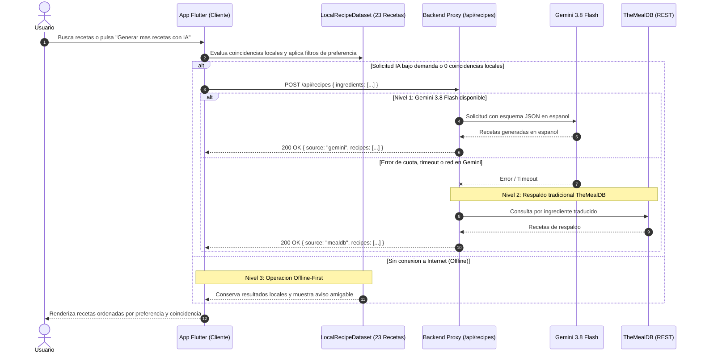

# Integración de Modelos de Lenguaje (*LLM*) y Estrategia de Respaldo - Food Friend

Este documento describe la integración de modelos de lenguaje e inteligencia artificial multimodal en **Food Friend**, los principios de seguridad aplicados, el diseño de *prompts*, los algoritmos deterministas que evitan llamadas innecesarias a la IA y la arquitectura de tolerancia a fallos (*fallbacks*).

---

## 1. Filosofía de Uso y Principios de Seguridad

De acuerdo con las reglas de arquitectura del proyecto:
1. **Uso Justificado y Mínimo (*Traditional First*):** La inteligencia artificial solo se invoca cuando los algoritmos deterministas y catálogos locales no pueden resolver el problema por sí solos:
   - **Resuelto sin IA (100% Determinista):** Búsqueda de ingredientes y resolución de errores tipográficos (distancia de *Levenshtein*), emparejamiento y *ranking* de recetas por preferencias/historial, variaciones de recetas para *meal prep* y el motor completo de **Consejos de Nutrición** (`NutritionService`).
   - **Resuelto con IA Multimodal / Generativa:** Visión computacional sobre fotos de refrigeradores abiertos, extracción de alimentos y precios en facturas arrugadas de supermercados guatemaltecos, y generación de recetas para combinaciones inusuales o bajo demanda explícita del usuario (`"Generar más recetas con IA"`).
2. **Seguridad y Cero Exposición de Credenciales:** La aplicación cliente en *Flutter* jamás contiene claves de API (*API keys*). Todas las llamadas pasan por las *Vercel Serverless Functions* en `/api/*`, que inyectan `process.env.GEMINI_API_KEY` en el servidor y sanean las entradas.
3. **Resiliencia Multinivel (*Graceful Degradation*):** Cada llamada a la IA cuenta con niveles de respaldo automáticos en el servidor y en el cliente para garantizar operación continua incluso sin conexión (*Offline-First*).

---

## 2. *Endpoints* Implementados con Gemini 3.8 Flash

Se utiliza **Gemini 3.8 Flash** (`gemini-3.8-flash`) mediante el *SDK* oficial `@google/genai` en el *backend proxy*:

### 2.1. Generación de Recetas Culinarias ([`POST /api/recipes`](file:///c:/Users/luisr/food-friend/api/recipes.ts))
- **Cuándo se invoca:**
  1. Automáticamente cuando los ingredientes seleccionados por el usuario no producen ninguna coincidencia en el recetario local de 23 recetas.
  2. Bajo demanda cuando el usuario pulsa el botón **`"Generar más recetas con IA"`** al final de `RecipeSuggestionsScreen`.
- **Entrada:**
  ```json
  {
    "ingredients": ["berenjena", "yuca"]
  }
  ```
- **Diseño del *Prompt*:**
  - Rol de *Chef* profesional experto en cocina guatemalteca y latinoamericana.
  - Salida 100% en español con ingredientes cotidianos en Guatemala y esquema JSON estricto (`response_mime_type: "application/json"`).

### 2.2. Detección en Refrigerador y Congelador ([`POST /api/detect-fridge`](file:///c:/Users/luisr/food-friend/api/detect-fridge.ts))
- **Propósito:** Identificar alimentos visibles en fotografías de refrigeradores, alacenas o congeladores.
- **Entrada:** Imagen codificada en *Base64* y su tipo *MIME* (`image/jpeg`, `image/png`, `image/webp`).
- **Procesamiento:** Asigna un índice de certeza (*confidence score* de `0.0` a `1.0`) y mapea cada alimento a las categorías del catálogo de Food Friend. La interfaz prioriza en la parte superior los elementos con certeza $\ge 0.8$.

### 2.3. Procesamiento de Facturas de Supermercado ([`POST /api/parse-receipt`](file:///c:/Users/luisr/food-friend/api/parse-receipt.ts))
- **Propósito:** Extraer productos alimenticios a partir de fotografías de facturas o tickets de supermercados guatemaltecos (*La Torre*, *Walmart*, *Paiz*, *Despensa Familiar*, *Maxi Despensa*).
- **Procesamiento:**
  - Decodifica abreviaturas *POS* locales y devuelve todos los precios en **Quetzales guatemaltecos (`GTQ` / `Q`)**.
  - Filtra y descarta artículos no comestibles (detergentes, bolsas, servilletas).

---

## 3. Diagrama de Secuencia y Arquitectura de Respaldo (*Fallbacks*)



---

## 4. Resumen de Estrategias de Respaldo por Funcionalidad

| Funcionalidad | Motor Principal | Respaldo Nivel 1 | Respaldo Nivel 2 (*Offline*) |
| :--- | :--- | :--- | :--- |
| **Búsqueda de Recetas** | `LocalRecipeDataset` (23 recetas locales + variaciones) | `POST /api/recipes` con **Gemini 3.8 Flash** | *TheMealDB API* y coincidencias parciales locales |
| **Generación con IA Bajo Demanda** | `POST /api/recipes` (**Gemini 3.8 Flash**) | *TheMealDB API* vía *proxy* | *SnackBar* informativo en español conservando las recetas locales en pantalla |
| **Escaneo de Refrigerador** | `POST /api/detect-fridge` (**Gemini 3.8 Flash Vision**) | Manejo de error estructurado en *proxy* | Ingreso manual rápido por búsqueda predictiva o categorías |
| **Escaneo de Facturas (`GTQ`)** | `POST /api/parse-receipt` (**Gemini 3.8 Flash Vision**) | Manejo de error estructurado en *proxy* | Ingreso manual rápido en pestaña *Buscar* o *Categorías* |
| **Consejos de Nutrición** | `NutritionService` (100% local y determinista) | No requiere red ni *LLM* | Siempre disponible sin conexión |
