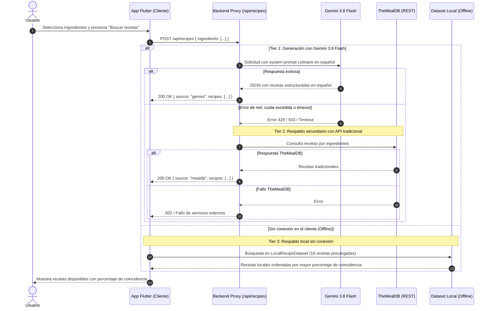

# Integración de Modelos de Lenguaje (LLM) y Estrategia de Respaldo - Food Friend

Este documento describe la integración de modelos de lenguaje e inteligencia artificial multimodal en **Food Friend**, los principios de seguridad aplicados, el diseño de *prompts* y la arquitectura de tolerancia a fallos (*fallbacks*).

---

## 1. Filosofía de Uso y Principios de Seguridad

De acuerdo con las reglas de arquitectura del proyecto:
1. **Uso Justificado y Mínimo:** La inteligencia artificial solo se utiliza en aquellos escenarios donde las herramientas tradicionales y los algoritmos deterministas son insuficientes (por ejemplo, visión computacional sobre fotos de refrigeradores, extracción de texto semiestructurado en recibos físicos arrugados, o generación de recetas para combinaciones inusuales sin coincidencias locales).
2. **Seguridad y Cero Exposición de Credenciales:** La aplicación cliente en *Flutter* jamás contiene claves de API (*API keys*). Todas las comunicaciones se canalizan a través del *backend proxy serverless* en `/api/*`, el cual inyecta de forma segura `process.env.GEMINI_API_KEY` en el entorno del servidor y valida cada solicitud.
3. **Resiliencia Multinivel (*Graceful Degradation*):** Cada llamada a la inteligencia artificial cuenta con múltiples niveles de respaldo automáticos. Si el servicio de LLM no responde, se agotan las cuotas o el usuario carece de conexión a Internet, la aplicación continúa funcionando fluidamente mediante APIs tradicionales o *datasets* locales.

---

## 2. Endpoints Implementados con Gemini 3.8 Flash

Se seleccionó **Gemini 3.8 Flash** (`gemini-3.8-flash`) mediante el SDK oficial `@google/genai` por su sobresaliente velocidad de inferencia, capacidad multimodal nativa y bajo consumo de recursos.

### 2.1. Generación de Recetas Culinarias (`POST /api/recipes`)
- **Propósito:** Generar recetas personalizadas y auténticas en español cuando el usuario busca platillos con combinaciones sin recetas locales precargadas (ej. `berenjena` + `yuca`).
- **Entrada:**
  ```json
  {
    "ingredients": ["berenjena", "yuca"]
  }
  ```
- **Diseño de Prompt e Instrucción del Sistema:**
  - Rol de *Chef* profesional experto en cocina guatemalteca y latinoamericana.
  - Generación 100% en español con ingredientes de fácil acceso en Guatemala.
  - Tiempos de preparación, cocción, porciones, dificultad y pasos claros y detallados.
  - Esquema estricto con `response_mime_type: "application/json"`.
- **Salida:**
  ```json
  {
    "source": "gemini",
    "recipes": [
      {
        "id": "gemini-salteado-yuca-berenjena",
        "title": "Salteado Rústico de Yuca y Berenjena al Ajillo",
        "description": "Una combinación deliciosa y reconfortante...",
        "mealType": "Almuerzo",
        "difficulty": "Fácil",
        "prepTimeMinutes": 15,
        "cookTimeMinutes": 20,
        "servings": 4,
        "ingredients": [ ... ],
        "instructions": [ ... ],
        "nutritionalInfo": { ... }
      }
    ]
  }
  ```

### 2.2. Detección en Refrigerador y Congelador (`POST /api/detect-fridge`)
- **Propósito:** Identificar ingredientes alimenticios presentes en fotografías de refrigeradores abiertos, repisas, cajones o congeladores.
- **Entrada:** Imagen codificada en *Base64* acompañada de su tipo *MIME* (`image/jpeg`, `image/png`, etc.).
- **Procesamiento y Filtro de Confianza:**
  - Clasifica cada alimento con un índice de certeza (*confidence score* entre `0.0` y `1.0`).
  - Asigna la categoría taxonómica sugerida del catálogo de Food Friend.
  - En la interfaz de usuario, los ingredientes se presentan ordenados dando prioridad absoluta a los de alta certeza ($\ge 0.8$), permitiendo al usuario seleccionarlos con una casilla de verificación antes de sumarlos a la despensa.

### 2.3. Procesamiento de Facturas de Supermercado (`POST /api/parse-receipt`)
- **Propósito:** Extraer automáticamente los productos alimenticios a partir de tickets o facturas emitidas por cadenas guatemaltecas (ej. *La Torre*, *Walmart*, *Paiz*, *Maxi Despensa*).
- **Moneda:** Todos los precios y montos totales se calculan y presentan en **Quetzales guatemaltecos (GTQ / Q)**.
- **Procesamiento:**
  - Extrae el nombre del supermercado y el total facturado.
  - Filtra artículos no comestibles (bolsas plásticas, productos de limpieza, etc.).
  - Mapea el texto del recibo con el ingrediente canónico del catálogo en español.

---

## 3. Diagrama de Secuencia y Arquitectura de Respaldo (*Fallbacks*)

El siguiente diagrama ilustra el flujo de ejecución y la degradación elegante ante fallos:



---

## 4. Pruebas de Resiliencia Realizadas

1. **Prueba de Red Caída:** Al desconectar la red o apagar el servidor proxy, `recipe_search_service.dart` captura la excepción `SocketException` de forma transparente y retorna las recetas coincidentes del catálogo local, informando al usuario sin interrupciones.
2. **Prueba de Combinaciones Cero-Locales:** Ante combinaciones como `berenjena` + `yuca`, el sistema contacta con éxito a Gemini 3.8 Flash, devolviendo recetas como *"Salteado Rústico de Yuca y Berenjena al Ajillo"* y *"Tortitas Doradas de Yuca con Relleno de Berenjena"* en español nativo con 100% de coherencia cultural.

