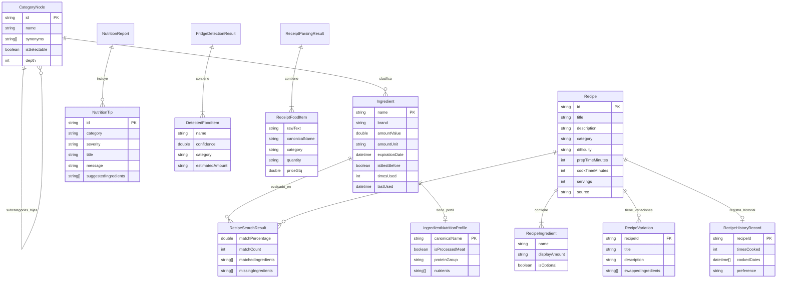

# Modelos de Datos - Food Friend

Este documento describe las entidades de dominio, estructuras de datos y relaciones utilizadas en **Food Friend** para la gestión de despensa, lista de compras independiente, escaneo inteligente, descubrimiento de recetas con variaciones, historial culinario y evaluación nutricional determinista.

---

## 1. Diagrama Entidad-Relación (*ER Diagram*)

El siguiente diagrama detalla los modelos de dominio centrales y sus relaciones de cardinalidad:

---

## 2. Detalle de Entidades Principales

### 2.1. `Ingredient` ([`lib/features/ingredients/domain/ingredient.dart`](file:///c:/Users/luisr/food-friend/lib/features/ingredients/domain/ingredient.dart))
Representa un ingrediente disponible en la despensa (`IngredientStorageService`) o pendiente en la lista de compras (`ShoppingListStorageService`).
- **`name`** (`String`): Nombre canónico en español sin marcas comerciales superfluas (ej. *"Harina de maíz"*, *"Pechuga de pollo"*, *"Tomate"*).
- **`brand`** (`String?`): Marca comercial opcional.
- **`amountValue`** (`double?`) y **`amountUnit`** (`AmountUnit?`): Cantidad numérica y unidad de medida (*gramos*, *libras*, *unidades*, *litros*, *tazas*, etc.).
- **`expirationDate`** (`DateTime?`) e **`isBestBefore`** (`bool?`): Fecha opcional de caducidad o consumo preferente.
- **`timesUsed`** (`int`) y **`lastUsed`** (`DateTime?`): Estadísticas internas incrementadas automáticamente cuando el usuario pulsa `"Lo cociné"` en una receta que utiliza el ingrediente.

### 2.2. `CategoryNode` ([`lib/features/ingredients/domain/category_node.dart`](file:///c:/Users/luisr/food-friend/lib/features/ingredients/domain/category_node.dart))
Estructura de árbol jerárquico utilizada para el catálogo taxonómico oficial de **195+ ingredientes** en español ([`IngredientCatalog`](file:///c:/Users/luisr/food-friend/lib/features/ingredients/data/ingredient_catalog.dart)).
- **`id`** (`String`): Identificador normalizado del nodo.
- **`name`** (`String`): Nombre cotidiano estilo supermercado guatemalteco (ej. *"Verduras para cocido y guisos"*, *"Quesos y crema"*, *"Frutos secos y semillas"*).
- **`children`** (`List<CategoryNode>`): Subcategorías hijas o ingredientes hoja seleccionables.
- **`synonyms`** (`List<String>`): Lista de sinónimos culinarios, regionalismos y marcas asociadas para búsqueda (ej. *"güisquil"* = *"chayote"*, *"harina de maíz"* = *"maseca"*).
- **Restricción Arquitectónica:** Profundidad máxima estrictamente menor o igual a 4 niveles ($\le 4$).

### 2.3. `Recipe` y `RecipeVariation` ([`lib/features/recipes/domain/recipe.dart`](file:///c:/Users/luisr/food-friend/lib/features/recipes/domain/recipe.dart))
Modelo completo de una receta de cocina junto con sus variaciones predefinidas para *meal prep*:
- **`id`**, **`title`**, **`description`**, **`category`**, **`difficulty`**: Metadatos principales en español.
- **`prepTimeMinutes`**, **`cookTimeMinutes`**, **`servings`**: Tiempos estimados y rendimiento en porciones.
- **`ingredients`** (`List<RecipeIngredient>`) e **`instructions`** (`List<String>`): Ingredientes requeridos y pasos de preparación.
- **`variations`** (`List<RecipeVariation>`): Lista de variaciones vinculadas ([`recipe_variation.dart`](file:///c:/Users/luisr/food-friend/lib/features/recipes/domain/recipe_variation.dart)), donde cada variación especifica el `recipeId` destino, título, explicación del cambio y los ingredientes intercambiados (`swappedIngredients`).

### 2.4. `RecipeHistoryRecord` y `RecipePreference` ([`lib/features/recipes/domain/recipe_history_record.dart`](file:///c:/Users/luisr/food-friend/lib/features/recipes/domain/recipe_history_record.dart))
Registra la interacción histórica del usuario con cada receta en [`RecipeHistoryService`](file:///c:/Users/luisr/food-friend/lib/features/recipes/data/recipe_history_service.dart):
- **`timesCooked`** (`int`): Contador total de veces cocinadas.
- **`cookedDates`** (`List<DateTime>`): Historial cronológico con validación de idempotencia diaria (`isCookedOn`).
- **`preference`** (`RecipePreference`): Enumeración con 5 estados (`favorite`, `liked`, `disliked`, `never`, `none`).
- **`cachedRecipe`** (`Recipe?`): Copia serializada de la receta cuando proviene de generación con IA para conservarla en `Gestión de Recetas`.

### 2.5. `IngredientNutritionProfile`, `NutritionTip` y `NutritionReport` ([`lib/features/nutrition/domain/`](file:///c:/Users/luisr/food-friend/lib/features/nutrition/domain/nutrition_tip.dart))
Modelos del motor determinista de nutrición:
- **`IngredientNutritionProfile`**: Define si un ingrediente es carne procesada/embutido (`isProcessedMeat`), su grupo proteico (`ProteinGroup`: `completeAnimal`, `incompleteLegume`, `incompleteGrainOrSeed`, `none`) y su aporte de micronutrientes (`TrackedNutrient`: *Vitamina A*, *Vitamina C*, *Hierro*, *Calcio*, *Fibra*).
- **`NutritionTip`**: Recomendación o alerta generada con título, explicación en español, severidad y lista de ingredientes sugeridos (`suggestedIngredients`) listos para añadirse a `ShoppingListStorageService`.
- **`NutritionReport`**: Resumen consolidado con el conteo de comidas cocinadas analizadas, ingredientes únicos consumidos y lista priorizada de consejos activos.

### 2.6. Controladores de Estado y Personalización
- **`SettingsController`** ([`lib/core/settings/settings_controller.dart`](file:///c:/Users/luisr/food-friend/lib/core/settings/settings_controller.dart)): Administra las preferencias de interfaz persistidas localmente (ocultar paneles de `Consejos de Nutrición` o `Gestión de recetas` en `HomeScreen`, retorno automático tras agregar un ingrediente y restablecimiento de *tooltips* de ayuda).
- **`ThemeController`** ([`lib/core/theme/theme_controller.dart`](file:///c:/Users/luisr/food-friend/lib/core/theme/theme_controller.dart)): Gestiona la alternancia reactiva entre el tema claro y el tema oscuro (*Material 3*).
