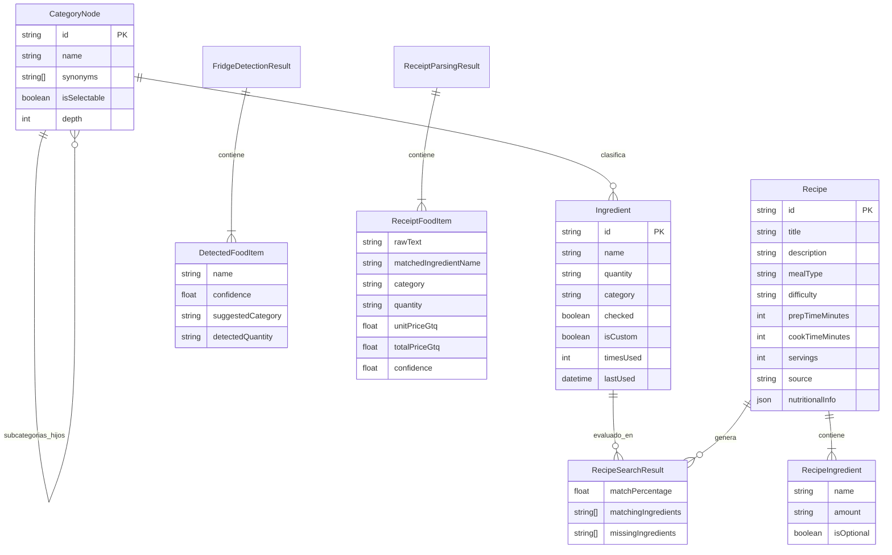

# Modelos de Datos - Food Friend

Este documento describe las entidades de dominio, estructuras de datos y relaciones utilizadas en **Food Friend** para la gestión de despensa, compras, escaneo inteligente y descubrimiento de recetas.

---

## 1. Diagrama Entidad-Relación (ER Diagram)

El siguiente diagrama detalla los modelos de dominio centrales y sus relaciones de cardinalidad:

---

## 2. Detalle de Entidades Principales

### 2.1. `Ingredient` (`lib/features/shopping_list/domain/ingredient.dart`)
Representa un ingrediente disponible en la despensa o lista del usuario.
- **`id`** (`String`): Identificador único (*UUID* o generado por *timestamp*).
- **`name`** (`String`): Nombre canónico en español (ej. *"Pechuga de pollo"*, *"Tomate"*).
- **`quantity`** (`String?`): Cantidad especificada (ej. *"2 libras"*, *"3 unidades"*).
- **`category`** (`String?`): Categoría taxonómica asignada (ej. *"Proteínas y Carnes"*).
- **`checked`** (`bool`): Estado de selección para compras o disponibilidad en despensa.
- **`isCustom`** (`bool`): Indicador de si el ingrediente fue ingresado libremente o proviene del catálogo oficial.
- **`timesUsed`** (`int`): Contador de frecuencia culinaria para sugerir elementos habituales.
- **`lastUsed`** (`DateTime?`): Fecha de último uso para ordenamiento por relevancia temporal.

### 2.2. `CategoryNode` (`lib/features/ingredients/domain/category_node.dart`)
Estructura de árbol jerárquico utilizada para el catálogo taxonómico oficial de ingredientes en español.
- **`id`** (`String`): Identificador normalizado de la categoría o nodo.
- **`name`** (`String`): Nombre visible en la interfaz (ej. *"Granos, Cereales y Harinas"*).
- **`children`** (`List<CategoryNode>`): Subcategorías hijas o ingredientes hoja seleccionables.
- **`synonyms`** (`List<String>`): Lista de sinónimos culinarios y nombres regionales (ej. *"güisquil"* = *"chayote"*, *"aguacate"* = *"palta"*).
- **`isSelectable`** (`bool`): Define si el nodo es una hoja seleccionable o una carpeta/categoría intermedia.
- **Restricción Arquitectónica:** Profundidad máxima estrictamente menor o igual a 4 niveles ($\le 4$), garantizando navegación ágil en un máximo de 3 a 4 toques táctiles.

### 2.3. `Recipe` (`lib/features/recipes/domain/recipe.dart`)
Modelo completo de una receta de cocina, apto tanto para el *dataset* local precargado como para recetas generadas dinámicamente por *Gemini 3.8 Flash*.
- **`id`** (`String`): Identificador alfanumérico único.
- **`title`** (`String`): Título descriptivo en español (ej. *"Pepián de Pollo Tradicional"*).
- **`description`** (`String`): Resumen culinario y perfil de sabor.
- **`mealType`** (`String`): Clasificación del tiempo de comida (*Desayuno*, *Almuerzo*, *Cena*, *Postre*, *Snack*).
- **`difficulty`** (`String`): Nivel de complejidad culinaria (*Fácil*, *Media*, *Difícil*).
- **`prepTimeMinutes`** y **`cookTimeMinutes`** (`int`): Tiempos estimados en minutos.
- **`servings`** (`int`): Rendimiento en porciones.
- **`ingredients`** (`List<RecipeIngredient>`): Lista detallada de ingredientes requeridos.
- **`instructions`** (`List<String>`): Pasos ordenados y detallados de preparación.
- **`nutritionalInfo`** (`Map<String, dynamic>?`): Información de macronutrientes aproximados (calorías, proteínas, carbohidratos, grasas).
- **`source`** (`String`): Origen de la receta (`local`, `gemini` o `mealdb`).

### 2.4. `RecipeSearchResult` (`lib/features/recipes/domain/recipe_search_result.dart`)
Resultado enriquecido tras ejecutar el algoritmo de coincidencia entre los ingredientes disponibles del usuario y los requisitos de cada receta.
- **`recipe`** (`Recipe`): Objeto de receta evaluado.
- **`matchPercentage`** (`double`): Porcentaje de coincidencia (0.0 a 100.0), calculado como $\frac{\text{ingredientes disponibles}}{\text{ingredientes obligatorios}} \times 100$.
- **`matchingIngredients`** (`List<String>`): Nombres de los ingredientes que el usuario ya tiene disponibles.
- **`missingIngredients`** (`List<String>`): Nombres de los ingredientes faltantes necesarios para preparar el platillo.

### 2.5. Modelos de Visión y Escaneo
- **`FridgeDetectionResult`:** Encapsula el análisis multimodal de una fotografía de refrigerador o congelador, conteniendo una lista de `DetectedFoodItem` con nivel de confianza (*confidence score* de 0.0 a 1.0) y categoría sugerida.
- **`ReceiptFoodItem`:** Modela una línea de producto detectada en una factura de supermercado guatemalteco, incluyendo descripción original del recibo, ingrediente normalizado en el catálogo, categoría, cantidad y precios en Quetzales guatemaltecos (`GTQ` / `Q`).

